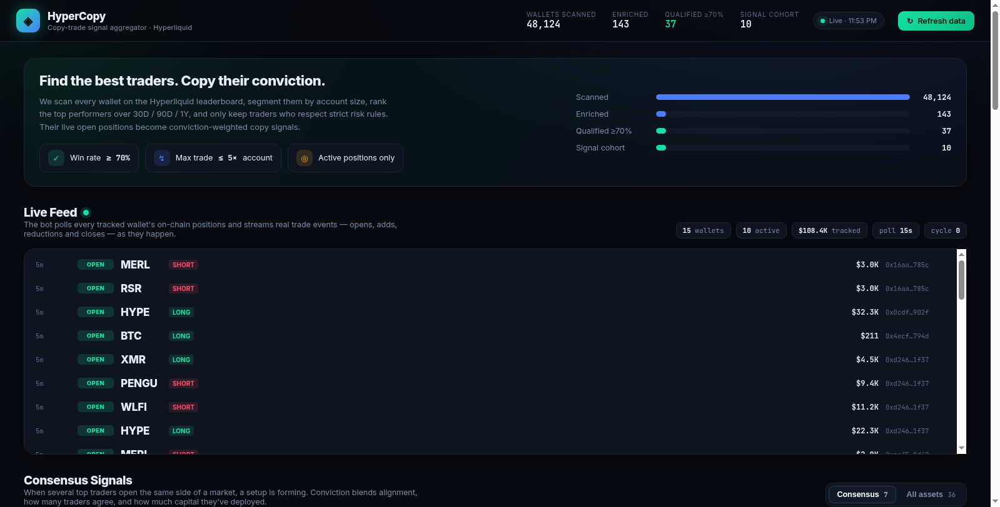
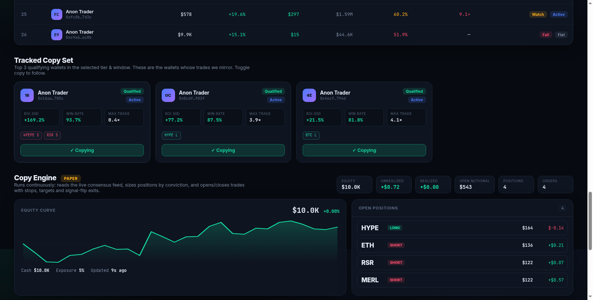

# HyperCopy — Copy-Trade Signal Aggregator for Hyperliquid

**Find the best Hyperliquid traders by account-size tier, filter them with strict risk rules, and turn their live open positions into conviction-weighted copy signals — with a real polling feed bot and a real copy-trade execution engine behind the dashboard.**


> **Live demo (static snapshot):** https://sites.super.myninja.ai/f703cfee-cf68-4614-9631-1b2b565a452a/57b67ac1/index.html
>
> The demo is a static capture. Run it locally for the fully live version with both bots running.



---

## Quickstart

```bash
git clone <your-repo-url> hypercopy && cd hypercopy

# one-command launch (creates venv, installs deps, starts server + bots)
./run.sh
```

Or manually:

```bash
python3 -m venv .venv && source .venv/bin/activate
pip install -r requirements.txt
python3 build_snapshot.py     # build data/snapshot.json from live Hyperliquid data
python3 server.py             # http://localhost:8000
```

Open **http://localhost:8000**. The dashboard loads immediately; the feed bot and
copy engine start automatically in the background.

Verify everything is healthy:

```bash
python3 smoke_test.py
# [PASS] health ok
# [PASS] bots started
# [PASS] live feed running
# ... All checks passed.
```

**No API keys are required.** Reads use Hyperliquid's public endpoints and the
copy engine defaults to paper mode.

---

## Table of contents

- [What it does](#what-it-does-mapped-to-the-original-idea)
- [How it works](#how-it-works)
- [The two bots](#live-bots-real-feed--real-copy-engine)
- [Configuration](#engine-configuration-configjson)
- [API reference](#api-endpoints)
- [Repository layout](#repository-layout)
- [Product decisions](#product-decisions-important)
- [Limitations & disclaimer](#limitations--disclaimer)

---

## What it does (mapped to the original idea)

| Idea from the chat | Implementation |
|---|---|
| Best traders by balance: `0–5k, 5–10k, 10–30k, 30–50k, 50–100k` | 5 balance tiers computed from live `accountValue` |
| Best over **30 days / 90 days / 1 year** | 30D & 1Y from the leaderboard windows; 90D computed from realized `closedPnl` in the last 90 days of fills |
| Max trade size **≤ 5× account size** | Live position notional ÷ account value must be ≤ 5× |
| **≥ 70% of wins** | Win rate computed from every realized close (`closedPnl > 0`) |
| Use wallets as **signals / copy trade** | Top-3 qualifying wallets per tier are the "Tracked Copy Set" |
| "If 5/20 have ETH longs, a setup is forming" | Consensus engine aggregates open positions per asset and measures long/short alignment across the active cohort |
| "The amount they put in shows how valid it is" | Conviction score weights **alignment + number of traders + capital deployed** |

---

## How it works

```
Hyperliquid leaderboard (48k wallets)
        │  segment by accountValue
        ▼
5 balance tiers ──► rank by 30D / 90D / 1Y performance
        │
        ▼  enrich top candidates (in ROI order, early-stop)
clearinghouseState  +  userFills
        │  → win rate, 90D realized PnL, live positions, leverage
        ▼
risk gates: win rate ≥ 70%  AND  max position ≤ 5× account
        │
        ├──► Tier Leaderboard (discovery)
        ├──► Tracked Copy Set (top 3 per tier, active-first)
        └──► Consensus Signals (aggregate live positions)
                    │
                    ▼
             feed_bot.py  ──►  live event stream
                    │
                    ▼
          copytrade_bot.py  ──►  paper / live orders
```

### Data sources (all public, no keys)

- `https://stats-data.hyperliquid.xyz/Mainnet/leaderboard` — all wallets, account value, PnL/ROI/volume per window.
- `POST https://api.hyperliquid.xyz/info` `{"type":"clearinghouseState","user":...}` — live open positions, leverage, unrealized PnL.
- `POST https://api.hyperliquid.xyz/info` `{"type":"userFills","user":...}` — trade history with `closedPnl` (used for win rate + 90D realized PnL).

---

## Live bots (real feed + real copy engine)

The dashboard is not a mock. `server.py` starts two background daemons on boot.

**`feed_bot.py` — the real feed.** Every 15 seconds it calls Hyperliquid's public
`clearinghouseState` endpoint for each wallet on the watchlist, converts the
response into a `{coin: position}` map, and diffs it against the previous cycle.
The first observation per wallet is treated as a baseline, so the bot does not
spam fake "OPEN" events on startup. Every genuine change becomes an event:

| Event | Meaning |
|---|---|
| `OPEN` | A position appears that did not exist before |
| `ADD` | Same side, notional increased |
| `REDUCE` | Same side, notional decreased |
| `CLOSE` | Position disappeared |
| `FLIP` | Side changed (long → short or vice versa) |

Events are written to `data/live.json` (ring buffer, last 400) and appended to
`data/feed_events.json`. The bot also recomputes consensus signals from the live
positions on every cycle, so the signal cards track the market in near real time.
On restart it seeds its buffer from the persisted log so the UI has history
immediately.

**`copytrade_bot.py` — the real execution engine.** It reads the same live
consensus feed and manages a portfolio. On each tick it first manages exits —
stop-loss, take-profit, max-hold timeout, and signal-flip exits — then looks for
entries. A trade is opened only when a signal clears three gates: at least
`minHolders` tracked traders agree, `alignment` is at least `minAlignment`, and
`conviction` is at least `minConviction`. Position size is
`equity × riskPerTradePct × convictionWeight`, capped by `maxLeverage` and total
exposure. Every action is written to `data/copy_state.json` with an order log,
open positions, closed trades, and an equity curve.

Two brokers implement the same interface:

- **PaperBroker** (default) — simulates fills at the current mark price and marks
  positions to market. No keys, no risk. This is what runs out of the box.
- **LiveBroker** — uses `hyperliquid-python-sdk` to place real orders. It is
  gated behind two environment variables: `HL_PRIVATE_KEY` must be set **and**
  `COPY_MODE=live`. Without both, the engine refuses to trade real money.



### Going live (read this first)

```bash
cp .env.example .env
# edit .env:
#   COPY_MODE=live
#   HL_PRIVATE_KEY=0x...        # an API/agent wallet key, not your main wallet
#   HL_ACCOUNT_ADDRESS=0x...    # your main account, if using an agent wallet
./run.sh
```

Use a dedicated **API wallet** funded only with what you can afford to lose.
Start in paper mode and watch the order log for a few days before switching.

---

## Engine configuration (`config.json`)

| Key | Default | Meaning |
|---|---|---|
| `mode` | `paper` | `paper` or `live` (live also requires `COPY_MODE=live`) |
| `startingEquity` | `10000` | Paper account starting balance |
| `riskPerTradePct` | `2.0` | Percent of equity risked per trade |
| `maxLeverage` | `3.0` | Cap on notional / equity per position |
| `maxPositions` | `5` | Maximum concurrent positions |
| `maxExposurePct` | `300.0` | Total notional / equity cap |
| `minHolders` | `2` | Minimum traders agreeing on a signal |
| `minAlignment` | `0.66` | Minimum long/short alignment |
| `minConviction` | `60` | Minimum conviction score |
| `stopLossPct` | `6` | Per-position stop-loss |
| `takeProfitPct` | `14` | Per-position take-profit |
| `maxHoldMinutes` | `720` | Time-based exit |
| `cooldownMinutes` | `20` | Cooldown after closing a market |
| `allowCoins` | `[]` | Empty = all markets |

`COPY_MODE` in the environment overrides `mode` in the file.

---

## API endpoints

| Endpoint | Method | Purpose |
|---|---|---|
| `/api/snapshot` | GET | Tier leaderboard, signals, tracked set |
| `/api/live` | GET | Feed heartbeat, positions, events, live signals |
| `/api/copy` | GET | Engine mode, equity, positions, orders, curve |
| `/api/events` | GET | Persisted feed event log |
| `/api/watchlist` | GET/POST | Read or add/remove/toggle watched wallets |
| `/api/config` | GET/POST | Read or update engine config |
| `/api/copy/reset` | POST | Reset the paper account |
| `/api/refresh` | POST | Rebuild the snapshot in the background |
| `/api/health` | GET | Server + bot status |

The dashboard's **Copy trader** buttons call `POST /api/watchlist`, so clicking
one genuinely adds or removes that wallet from the feed bot's watchlist.

---

## Repository layout

```
.
├── server.py             # FastAPI app; starts both bots on startup
├── build_snapshot.py     # leaderboard → tiers → ranking → enrichment → signals
├── hl.py                 # shared Hyperliquid API helpers
├── feed_bot.py           # position-diff live feed (OPEN/ADD/REDUCE/CLOSE/FLIP)
├── copytrade_bot.py      # copy execution engine (paper + live brokers)
├── config.json           # engine risk parameters
├── smoke_test.py         # end-to-end API health checks
├── run.sh                # one-command launcher
├── requirements.txt
├── .env.example
├── web/                  # dashboard source (HTML/CSS/JS)
│   ├── index.html
│   ├── styles.css
│   └── app.js
├── dist/                 # self-contained static build (deployable)
├── docs/                 # screenshots
└── data/                 # generated state (snapshot, live feed, copy state)
```

### Static mode

`dist/` is a self-contained build (HTML/CSS/JS + `snapshot.json` + last-known
`live.json` / `copy.json`). It auto-detects the absence of `/api/snapshot` and
falls back to the bundled files, hiding the live panels if no captured state
exists. This is what the public demo URL serves.

---

## Product decisions (important)

- **Win rate** is computed per *realized close* (a fill with non-zero `closedPnl`). This is a robust proxy for "how often a trade wins."
- **"Max trade size ≤ 5× account"** is interpreted as **live position notional ÷ account value** — i.e. the leverage you would actually be copying. (Historical max position was tried but is too noisy because account value changes over time.)
- **70% is the strict copy gate.** Because 70% is genuinely rare (median trader wins ~45%), the **consensus signal engine uses a slightly broader "signal-grade" cohort: ≥ 60% win rate, ≤ 5× leverage, and currently active.** This keeps enough traders to form a statistically meaningful consensus without copying weak wallets. The strict ≥70% qualifiers are still shown and counted.
- **Active-first selection:** the copy set prefers traders who currently hold positions, because a flat wallet can't be copied right now. Flat qualifiers are still listed, badged `Flat`.
- **ROI cap for ranking:** wallets that grew from a dust balance can show absurd ROI (e.g. +40,000%). Ranking caps ROI at 10× and tiebreaks by dollar PnL so dust-account explosions don't dominate. Display shows large ROIs as multiples (e.g. `415×`).

---

## Current snapshot (example run)

- **48,124** wallets scanned → **143** enriched with trade-level data
- **37** wallets pass the strict ≥70% / ≤5× gate
- **10** active signal-grade traders drive consensus
- Example signals: `HYPE` 3 long / 1 short (conviction 82), `kPEPE` 3/3 short, `BTC` & `ZEC` split 2/2

---

## Limitations & disclaimer

- The dashboard snapshot is point-in-time, but the feed bot runs a live polling loop (15s) and the copy engine acts on it. The feed is polling-based, not websocket-based, so entries can lag a fast market by up to one poll interval.
- Paper mode fills at the mark price and ignores slippage, funding, and fees; live results will differ.
- `userFills` returns the most recent 2,000 fills — win rate is computed over that window.
- The 90D window is derived from fills (the leaderboard only exposes day/week/month/all-time).
- **Not financial advice.** Crypto perpetuals are high-risk. Copy-trading can lose more than expected. Always size positions yourself. See [LICENSE](LICENSE) for the full trading disclaimer.

---

## License

MIT — see [LICENSE](LICENSE).
